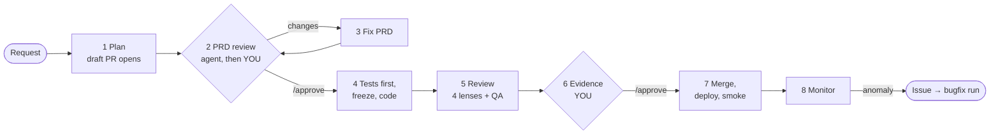

# factory2

**A Claude Code plugin that takes one feature from request to production through eight gated stages:
tests before code, separate reviewers, two human approvals on a draft PR, and lessons that carry over
to the next run.**

[](LICENSE)
[](https://code.claude.com/docs)


---

## Why

Coding agents are good at writing code and bad at judging it. Left alone, they under-scope the spec,
grade their own work, and when a test is in the way they may weaken the test instead of fixing the code.
factory2 splits the work between agents that don't share a context and lets **scripts, not agents,
decide pass or fail**:

- **Acceptance tests come first and are then frozen.** The tests and the files that define "the checks"
  (`package.json` scripts, runner and lint configs, CI) are hashed before any product code exists. Hooks
  block edits to them, and the implementer can't finish while a hash has changed.
- **A criterion passes only when its tests pass.** Each acceptance criterion (`AC-n`) is tied to tests by
  name, and the harness reads the JUnit reports. No agent can mark it done.
- **You approve two things, both on the PR:** the **plan** (what will be built and how, shown in the
  approval request, before any code) and the **evidence** (screenshots and a video per criterion, before
  merge). Comments on the PR are corrections; a `/approve` comment is the approval.
- **It learns.** Every miss becomes a reviewed calibration line for the agent that missed it, and
  lessons that generalize go to `docs/solutions/` for the next run's planner and reviewers.

## How it works



| Stage | What happens |
|---|---|
| 1. Plan | A draft PR opens with your request. A planner writes a product-level PRD with EARS acceptance criteria, a `contract.json`, and a `plan.md` saying how it will be built. Every step is committed and announced on the PR. |
| 2. PRD review | A reviewer agent checks the spec in a fresh context, then factory asks you on the PR. The approval request shows every criterion and the full plan. |
| 3. Fix PRD | The planner answers each finding and each of your comments; back to 2. |
| 4. Implement | A test-author writes failing tests per criterion, a test-reviewer checks them, they are frozen, then the implementer writes the code (low effort first, a fresh high-effort run on failure). |
| 5. Review | Correctness, spec, security and maintainability lenses, a challenger that tries to refute each blocking finding, and a QA agent that drives the running app. Every fix starts with a failing test. |
| 6. Evidence | Screenshots per viewport and a video with a chapter per criterion, in a review pack. Your comments are routed as spec gap, defect or cosmetic. |
| 7. Ship | Merge, deploy and smoke test, with no further approval. |
| 8. Monitor | A production anomaly files an issue first; the fix is a new bugfix run through every stage. |

The [user guide](docs/GUIDE.md) walks through each stage in detail.

## Status

**Beta.** All eight stages are built and tested: the orchestrator, the 14 agents, the hooks and every
harness script, with 700+ checks in the bash suites, live hook tests, and a real Playwright capture
that produced the review pack. What hasn't happened yet is a full run on a production project, and the
PR flow has been tested against a stand-in `gh` rather than GitHub itself. See
[Status and build order](docs/PRD.md#status-and-build-order).

## Requirements

- [Claude Code](https://code.claude.com/docs) 2.1.311 or later
- `git`, `jq` and `python3`
- Recommended: [`gh`](https://cli.github.com/), logged in, with an `origin` remote. Runs are then
  tracked and approved on a draft PR; without it, approvals happen in the terminal.
- For web projects: Playwright 1.59 or later (1.64+ recommended) and `@playwright/cli`
- Recommended: `ffmpeg`, so review-pack videos are H.264 mp4 (`brew install ffmpeg` or
  `apt-get install ffmpeg`); without it they stay WebM
- Optional: `docker` (pinned Playwright browsers)

## Quick start

```sh
claude plugin marketplace add hlistan/factory2
claude plugin install factory2@factory2
```

Then, in your project, inside Claude Code:

```text
/factory2:init                          # checks the environment, writes .factory/config.yaml
/factory2:run "Add a dark-mode toggle"  # starts a run and opens its draft PR
```

Every feature is one GitHub issue: the run creates it from your request (or works on yours, `--issue
<n>`), and its status follows the work: `todo` → `planning` → `building` → `testing` → `documenting` →
closed when its last PR merges. When factory needs you, the PR and the issue are `blocked` and a comment
on the issue names the PR and says exactly what to reply (`/approve`, or your corrections). To see what
waits for you, and what is ready to build:

```sh
gh issue list --label blocked   # approvals and questions waiting for you
gh issue list --label todo      # wanted; /factory2:run with no arguments lists these
```

Your project's checks are its own commands. Each writes JUnit XML into `$FACTORY_REPORTS`, and a test
names its criterion with `@AC-n` in its title (or `AC_n` in a Go or Swift function name).

## Commands

| Command | What it does |
|---|---|
| `/factory2:init` | Checks the environment and writes `.factory/config.yaml` for your stack |
| `/factory2:run "<feature>"` | Starts a run; `/factory2:run <slug>` resumes one |
| `/factory2:run --issue <ref>` | Starts a bugfix run from an issue (GitHub number or URL, or a local incident file) |
| `/factory2:run` | Lists the issues labelled `todo`, ready to build |
| `/factory2:status` | Where the active run stands, and what waits for you |
| `/factory2:issue-flow` | The issue flow on its own: set up its labels, show an issue and its PRs, move them ([interactive schema](docs/issue-flow.html)) |
| `/factory2:monitor <slug>` | One round of production checks; pair with `/loop 15m` |
| `/factory2:stats` | Spend, first-pass rates, human-found issues and QA misses across runs |

## Configuration

`/factory2:init` writes `.factory/config.yaml`. It covers your check commands, how to start the app,
round limits and budget, who may approve on the PR (`review.reviewers`), deploy, smoke and rollback
commands, monitoring, and per-agent model overrides (`roles`). The annotated template,
[`plugins/factory2/templates/factory.config.yaml`](plugins/factory2/templates/factory.config.yaml),
documents every setting.

Agents run on Opus 5.5 at medium effort by default. The exceptions: the implementer starts at low
effort, the learnings researcher runs at high, the researcher uses Sonnet 5.5, and the security reviewer
uses Fable 5.1, falling back to Opus when your account doesn't have it.

## Documentation

- [User guide](docs/GUIDE.md): how a run works step by step, your gates, monitoring, controlling
  results, and how it learns
- [Design](docs/PRD.md): decisions, models and the evidence behind them, safety mechanisms, verified
  platform behaviour, build status
- [Plugin README](plugins/factory2/README.md): the plugin at a glance
- [`docs/solutions/`](docs/solutions/): lessons learned while building factory2, in the format it
  writes for your projects

## Repository layout

```
plugins/factory2/      the plugin: agents, skills, hooks, scripts, templates, evals
tests/                 bash suites for the scripts; tests/live/ for live platform tests
tools/vendor-ce.sh     updates the bundled compound-engineering skills to another release
docs/                  user guide, design, lessons learned
```

This repository is also the plugin's marketplace (`.claude-plugin/marketplace.json`).

## Development

```sh
bash tests/run.sh            # every bash suite; needs git, jq, python3
bash tests/live/deps.sh      # live: installs and loads from git and from a directory (no login needed)
bash tests/live/hooks.sh     # live: hooks fire in real Claude Code sessions (uses your login, spend-capped)
bash tests/eval.sh           # agent evals with `claude plugin eval` (uses your login)
```

`hooks.sh` and `eval.sh` run real sessions and spend tokens; the bash suites and `deps.sh` don't.

## Contributing

Issues and pull requests are welcome. For a change in behaviour:

1. Open an issue first, so the design can be discussed. [`docs/PRD.md`](docs/PRD.md) says what each
   part is for.
2. Add or update tests in `tests/`, and keep `bash tests/run.sh` green.
3. Update [`docs/GUIDE.md`](docs/GUIDE.md) and [`docs/PRD.md`](docs/PRD.md) when user-visible
   behaviour changes.
4. Don't edit `plugins/factory2/skills/ce-compound*/` by hand: they are byte-checked copies of an
   upstream release. Use `tools/vendor-ce.sh`.

## Security

The hooks are **seatbelts, not a security boundary**. They stop an agent's mistakes; they don't contain
a determined attacker. The guard blocks force-pushes, skipped git hooks, `rm -rf` of `/` or home, deploys
outside an approved run, and an agent posting approvals on the run's PR. Run factory2 only on code and
in accounts you would let Claude Code act in anyway.

To report a vulnerability, please don't open a public issue: contact the maintainer privately through
their [GitHub profile](https://github.com/hlistan).

## Acknowledgements

- [compound-engineering](https://github.com/EveryInc/compound-engineering-plugin) by Every (MIT):
  factory2 bundles unchanged copies of its `ce-compound` and `ce-compound-refresh` skills (release
  3.34.0) and a port of its learnings researcher.
- singularity 0.7.0 (MIT): factory2's gate scripts (`guard-bash`, `test-guard`, `run-checks`,
  `subagent-stop`, `change-diff`) are ported from it.
- The design draws on Anthropic's engineering posts on
  [harness design](https://www.anthropic.com/engineering/harness-design-long-running-apps) and
  [effective harnesses](https://www.anthropic.com/engineering/effective-harnesses-for-long-running-agents);
  the [design doc](docs/PRD.md#sources) lists every source.

## License

[MIT](LICENSE)
