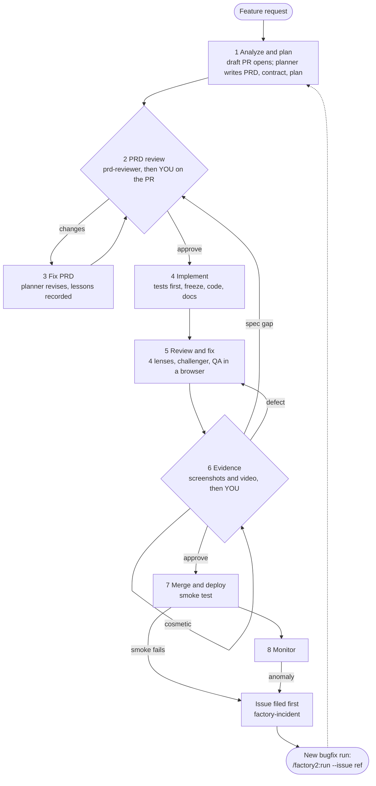
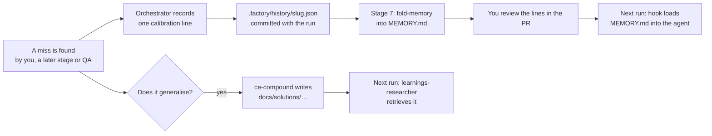

# factory2: user guide

How the harness works, how to run a feature through it, how to watch it, how to keep control of what it
produces, and how it learns from your feedback.

> **Build status (v0.1.0).** Stages 1–5 are complete: the orchestrator instructions, the agents, the hooks
> and the harness scripts, with unit tests and live hook tests. Stages 6–8 have their instructions and
> agents, but four scripts are still to come: `evidence.sh` (M5), `ship.sh` and `monitor.sh` (M6), and
> `stats.sh` (M7). Until then the orchestrator stops at the start of stage 6 and reports the missing
> script. Sections that depend on these scripts are marked *(M5)*, *(M6)* or *(M7)*.

---

## 1. The idea in one picture



A production problem never reopens the run that shipped it. It becomes an **issue**, and the fix is a
new **bugfix run** through the same stages and gates.

Three rules hold the whole thing together:

1. **Agents do the work; scripts decide pass or fail.** Whether a check passed comes from an exit code,
   and whether an acceptance criterion is met comes from JUnit test reports. No agent can declare
   success.
2. **Tests come before code, and then they're frozen.** The tests and the files that define "the checks"
   (`package.json`, runner and lint configs, CI, `.factory/config.yaml`) are hashed before any product
   code exists. The implementer can't change them to make the work pass.
3. **You approve two things, both on the PR:** the plan (stage 2: what will be built and how, before
   any code) and the evidence (stage 6: what was built, before merge). Merge, deploy and any rollback
   follow without asking. Each approval is tied to a commit, and going back a stage cancels it.

### Who does what

| Agent | Job | Model and effort | Can edit files? |
|---|---|---|---|
| Orchestrator (`/factory2:run`, your session) | Routes work, runs scripts, stops at gates | Opus, medium | Only run state, through scripts |
| `planner` | Writes `prd.md`, `contract.json` and `plan.md` | Opus, medium | Spec files |
| `prd-reviewer` | Reviews the PRD in a fresh context | Opus, medium | No |
| `learnings-researcher` | Finds past lessons before planning and review | Opus, high | No |
| `researcher` (optional) | Answers specific outside questions | **Sonnet 5.5**, high | No |
| `test-author` | Writes one or more `@AC-n` tests per criterion | Opus, medium | Tests |
| `test-reviewer` | Checks every criterion is covered and every assertion means something | Opus, medium | No |
| `implementer` | Writes the code, then the docs | Opus, **low** on the first pass; a **fresh** spawn at **high** for each retry | Product code |
| `reviewer-correctness`, `reviewer-spec` | Blocking review lenses | Opus, medium | No |
| `reviewer-security` | Blocking lens | **Fable 5.1**, high | No |
| `reviewer-maintainability` | Advisory lens | Opus, medium | No |
| `challenger` | Tries to refute each blocking finding | Opus, medium | No |
| `qa-evaluator` | Drives the running app, one pass or fail per criterion | Opus, medium | No |
| `triager` | Classifies your comments; diagnoses incident issues and posts the diagnosis on the issue | Opus, medium | No |

The default is **Opus 5.5 at medium effort**. The exceptions:

- `learnings-researcher` runs at high.
- `researcher` runs on Sonnet 5.5 at high.
- `reviewer-security` runs on Fable 5.1 at high. Fable 5.1 isn't available under zero data retention
  unless Anthropic authorises it. If the spawn fails for that reason, the orchestrator re-runs the
  review once on Opus and tells you. Set `roles.reviewer-security: {model: opus, effort: high}` to make
  that permanent.
- `implementer` keeps its low-then-high policy.

Every spawn takes its model and effort from the agent's own definition, or from your `roles:` override.

You can override a model or effort per agent in `roles:` (see §5.5). Do it only after `/factory2:stats`
shows the override holds up on your own runs.

---

## 2. One-time setup

1. **Install the plugin.**
   ```sh
   claude plugin marketplace add <factory2 marketplace: git URL or local path>
   claude plugin install factory2@factory2
   ```
   That's all: factory2 bundles the two compound-engineering skills it uses (ce-compound and
   ce-compound-refresh), pinned to one release, so it needs no other plugin. If you also use
   compound-engineering for its other workflows, install it as usual; both write the same
   `docs/solutions/`.
2. **Open the project in Claude Code and run `/factory2:init`.** It:
   - runs `doctor.sh`: Claude Code ≥ 2.1.311, hooks not disabled, no other plugin named `factory2`,
     `CLAUDE_CODE_EFFORT_LEVEL` unset, the bundled ce-compound present, `git`, `jq` and `python3` present;
   - writes `.factory/config.yaml` from your build files and runs each check once to prove the commands
     exist;
   - for web projects, offers to install `@playwright/cli`;
   - adds `.factory/runs/` and `.factory/incidents/` to `.gitignore`.
3. **Review `.factory/config.yaml`** (template: `plugins/factory2/templates/factory.config.yaml`). The
   parts that matter most:
   - `checks.fast`: run after every implementer turn. Keep them under about 7 minutes; the gate has a
     14-minute limit.
   - `checks.slow`: integration and e2e, run by the orchestrator.
   - Every check must write JUnit XML into `$FACTORY_REPORTS`. That's how a test named `@AC-3 …` turns
     criterion AC-3 green.
   - `checks.check_defining`: the files frozen alongside the tests.
   - `limits`: round limits and the budget.
   - `ship` and `monitor`: your deploy, smoke, rollback and health commands. Leave them empty until you
     need them.
4. **Commit** the config and `.gitignore` changes.

> If `CLAUDE_CODE_EFFORT_LEVEL` is set in your shell, unset it and restart Claude Code. It overrides
> every agent's effort, including the per-role levels factory2 sets, so `/factory2:run` refuses to start
> until you either unset it or explicitly accept running every agent at that one level.

---

## 3. Running a feature, step by step

Start a run:

```
/factory2:run "Add a dark-mode toggle to the settings page"
/factory2:run --issue 123          # a bugfix run from a GitHub issue (number or URL), or a local incident file
```

The orchestrator proposes a short slug (for example `dark-mode-toggle`) and asks you to confirm it. From
then on, everything for the run lives in three places:

| Where | What | In git? |
|---|---|---|
| The run's draft PR | Every planning step as a comment; the artifacts, approvals and review ledger in its description | On GitHub |
| `docs/specs/<slug>/` | `request.md`, `prd.md`, `contract.json`, `plan.md`, `reviews/`, `feedback/` | Committed |
| `.factory/history/<slug>.json` | The run's measurement record and lesson lines | Committed |
| `.factory/runs/<slug>/` | State, freeze hashes, reports, logs, evidence | Ignored |

One run per checkout. For a second feature in parallel, start another session with `claude --worktree`;
each run gets its own branch and dev-server port.

### Stage 1: analyze and plan (automatic)

> **Bugfix runs** (`--issue`) follow exactly the same stages. The differences: the planner reads the
> issue and every comment on it (including the triager's diagnosis), and writes a bugfix PRD. Its
> Problem section is the failure as observed, with the evidence; a Root cause section gives the
> diagnosis; and **AC-1 is the regression criterion** that reproduces the failure, so its test is
> written first and must fail on today's code. The PR says `Fixes #<n>`, so merging closes the issue.

1. Updates the default branch, then creates `factory/<slug>` and records its base commit.
2. **Opens the draft PR.** Your request is committed as `request.md`, the branch is pushed, and the
   draft PR opens (`ship.pr_open`). From here you can follow everything on the PR: each planning step is
   committed, pushed and announced in a comment that says what was added or changed, with a compare
   link. The PR description lists the artifacts, the approvals and a review ledger. (With
   `review.via: terminal`, or without gh, its login or an `origin` remote, the gates stay in the
   terminal and the PR opens at stage 4.)
3. `learnings-researcher` pulls relevant past lessons from `docs/solutions/`.
4. Optionally, `researcher` answers outside questions (an API's limits, a standard).
5. `planner` writes:
   - **`prd.md`**, at product level: the problem, users, scope and non-goals, UX flows including empty,
     loading, error and permission states, and acceptance criteria in EARS form ("WHEN … THE SYSTEM
     SHALL …"), each with the test level that will prove it. Also NFRs, risks, rollout, and the
     monitoring signals.
   - **`contract.json`**: one entry per criterion, with `passes: false`.
   - **`plan.md`**: how it will be built, written for you to approve: a summary of what will be built,
     the approach (components and files changed, data and schema changes, interfaces), the decisions
     with the alternatives rejected, steps mapped to criteria (tests first), the files touched, the
     risks, and an `## Exceptions` list for any dependency or check-file change the work genuinely
     needs. Once you approve it, the implementer follows it and reports any deviation with its reason.
6. Commit `factory(<slug>): 1 plan`, push, and comment on the PR: the files added, the number of
   criteria, the planner's open questions (answer them in a PR comment), and the plan itself in a
   collapsed section.

### Stage 2: PRD review (⏸ your gate)

1. `prd-reviewer` reviews the PRD in a fresh context. Is each criterion testable? Are all the states
   covered? Does every quoted figure appear in its cited source?
2. The reviewer's findings are posted on the PR, grouped by severity, and saved to
   `reviews/prd-review-<n>.json`. With blocking findings the run goes straight to stage 3; you don't
   have to wait for a request to comment.
3. **Your gate is on the PR.** When the reviewer has nothing blocking, factory posts an **approval
   request** naming the commit, and waits. The request itself shows **what will be built** (every
   acceptance criterion) and **how the planner proposes to build it** (`plan.md` in full: summary,
   approach, decisions, steps, files, risks), plus any open questions, so you can decide from the
   comment.
   - **Correct**: comment on the PR, in the conversation or inline on `prd.md` or `plan.md`. Each
     comment is saved word for word, with its author, link and line, to
     `docs/specs/<slug>/feedback/prd-<n>.md`, and goes to stage 3. factory replies to say it received them.
   - **Approve**: reply with a comment whose first line is `/approve`. Anything after that line is
     saved as notes for the run. The approval holds for the named commit only: if anything was pushed
     after it, or a correction arrives in the same batch, factory says so and asks again. If the
     reviewer still has blocking findings, the request says so and your `/approve` is recorded as an
     override.
   - Only comments from people in `review.reviewers` count (default: the repository's owners, members
     and collaborators). Anyone else's comments are ignored, and you're told about them.
   - factory can't approve for you: approving in the terminal is refused on a PR run, and the guard
     blocks Claude from posting comments or reviews on the PR except through `pr.sh`, which marks
     its own comments.
   - **Stop**: tell Claude in the terminal. Resume later with `/factory2:run <slug>`; the comments
     you leave in the meantime are read when it resumes.
4. With `review.via: terminal`, you see the criteria list, the plan's summary, approach and decisions,
   the reviewer's findings and the open questions in Claude Code instead, and approve, request changes or stop there. Approving with
   blocking findings open asks once more and records the override.

### Stage 3: fix PRD (automatic, loops back to 2)

The planner revises all three files and answers each finding and each of your corrections: what
changed, or why it disagrees. The revision and its answers are posted on the PR with the changed files,
and the review ledger in the PR description marks each finding fixed, declined or open. Then
the lessons are recorded (§6.2):

- Something **you** caught that the reviewer missed becomes a lesson line for `prd-reviewer`.
- A gap the planner should have covered becomes a lesson line for `planner`.

After `limits.prd_rounds` rounds (3 by default), the orchestrator stops and asks you how to proceed.

### Stage 4: implement, tests first (automatic)

| Step | What happens | What decides |
|---|---|---|
| 4.0 Baseline | Runs every check on the unchanged code and saves the ones already failing; those never block this run | `state.sh baseline` |
| 4a Tests | `test-author` writes `@AC-n` tests at the level the PRD names | — |
| 4a1 Red check | Every new test must **fail** before the code exists. A test that already passes, or that can't be seen in the reports, goes to the reviewer. | `state.sh red-check` |
| 4a2 Test review | `test-reviewer` checks coverage and that every assertion means something; up to 3 rounds | Its verdict |
| Freeze | Commits the tests, then hashes the tests and check-defining files, snapshots the check commands, and saves a copy of the reviewed plan | `state.sh freeze` |
| 4b Code | `implementer` at **low** effort. When it tries to stop, a hook re-verifies the freeze and runs the fast checks; it can't finish while they fail (up to 3 retries). | `subagent-stop.sh` |
| After 4b | Verifies the freeze, runs all checks, and syncs `passes` in `contract.json` from the JUnit reports | `verify-freeze`, `run-checks.sh`, `contract-sync` |
| Retry | On failure: a **fresh** implementer at **high**, briefed with the failure report; up to 2 retries, then you | — |
| 4c Docs | README, docs, CHANGELOG | Fast checks |
| 4d PR | Push and refresh the PR description (a terminal run opens the draft PR here with `ship.pr_open`) | — |

A criterion counts as passing only when at least one test names it and every test that names it passed.

If the implementer reports that a frozen test is wrong, or that it needs a new dependency, it is stopped:

- **A wrong test** goes back through test-author, then test-reviewer, then a re-freeze.
- **A dependency** is added by the planner to `plan.md`'s Exceptions, then re-frozen. Only an Exception
  that was frozen counts. One an agent writes into `plan.md` afterwards is ignored.

### Stage 5: review and fix (automatic)

1. `learnings-researcher` pulls lessons relevant to the diff.
2. Mechanical checks and `contract-sync`. Any failure is a blocking finding.
3. **Depth** (`limits.depth`):
   - **lite**: a small diff (under `lite_max_lines`) that touches nothing on `risk_list`. Runs the
     correctness and spec lenses only.
   - **full**: all four lenses, plus a challenger for each blocking finding.
4. In parallel with the lenses, the app is started on the run's port and `qa-evaluator` drives it with
   `playwright-cli`, giving one pass or fail per criterion with a screenshot or trace as evidence.
5. **Challenger** (full depth only):
   - **confirmed**: stays blocking.
   - **refuted**: becomes advisory.
   - **unproven**: stays blocking until a failing test proves it or can't be written.
6. **Fix loop**, for each blocking finding and each QA fail:
   1. `test-author` writes a failing test that reproduces it.
   2. The red check confirms the new test fails.
   3. `test-reviewer` reviews it, and the freeze is extended to cover it.
   4. A fresh implementer at **high** fixes the code.
7. Only the lenses that blocked review again. After `limits.review_rounds` rounds (2 by default), it
   stops and asks you.

Advisory findings are not fixed automatically; you see them at the stage 6 gate.

### Stage 6: evidence (⏸ your gate) *(M5)*

1. The `@AC-n` e2e tests are the demo script. They run under a demo Playwright config that records a
   video with a chapter per criterion, and screenshots at 1440, 768 and 390 pixels wide. The video is
   converted to mp4 when ffmpeg is installed.
2. A **review pack** is built at `.factory/runs/<slug>/review-pack/index.html`. For each criterion it
   shows the text, its tests, pass or fail, the screenshots and the video chapter. It also lists the
   advisory findings, spend so far and the PR link.
3. **You** approve or comment on the PR: factory posts an approval request with the pack's link
   (when `evidence.publish` is set), the criteria table and the advisory findings. Reply `/approve`, or
   comment. The `triager` sorts each comment:

   | Class | Meaning | Where it goes |
   |---|---|---|
   | `spec-gap` | The PRD didn't ask for it | The planner amends the PRD, then back to stage 2 |
   | `defect` | A criterion isn't met | The stage 5 fix loop, starting with a failing test |
   | `cosmetic` | No criterion is affected | A direct fix, then the evidence is captured again |

4. On approval, the approved commit is recorded and the PR is marked ready.

### Stage 7: merge and deploy *(M6)*

1. Merges `origin/<default>` into the branch. On a conflict it stops and asks you.
2. Folds the run's lesson lines into each agent's memory and commits only those files. **You see the
   added lines.**
3. `ship.sh verify` checks that every commit after your evidence approval is either a clean merge from
   main or the memory fold. Anything else sends the run back to stage 6.
4. Merges the PR and deploys, without asking again: your evidence approval covers it. A hook blocks
   the deploy command outside stage 7 or without that approval. The deployed commit and the smoke
   result are noted on the PR.
5. Runs the smoke tests. If they fail, it **files an issue first**, rolls back (when `ship.rollback` is
   set) and comments that on the issue and the PR, and offers a bugfix run for the issue. The change is already merged, so the run itself doesn't go back.
6. **For a bugfix run:** comments the deploy on the issue (the merge closed it), writes the postmortem
   (§6.2), and records lesson lines for the agents of the run that shipped the bug.

### Stage 8: monitor *(M6)*

See §4.2.

### Resuming and stopping

| You want to | Do |
|---|---|
| Continue a paused run | `/factory2:run <slug>` (a new session also tells you which run is active) |
| Fix an issue (an incident or any bug report) | `/factory2:run --issue <ref>`. Use `claude --worktree` while another run holds the checkout (for example one still being monitored). |
| Restart from a stage | `/factory2:run <slug> --from <n>`. Going back cancels approvals given at that stage or later. |
| Abandon a run | Stop at any gate, run `bash <plugin>/scripts/state.sh end` to release the checkout, then delete `.factory/runs/<slug>/` and the branch if you don't need them. The committed spec and history stay. |

---

## 4. Monitoring

### 4.1 Watching a run in progress

| Question | Where to look |
|---|---|
| Where is the run? | `/factory2:status`: stage, phase, rounds against limits, approvals with commit SHAs, PR, whether frozen, the criteria table, spend against budget, open incidents |
| What will it cost? | `bash <plugin>/scripts/state.sh spend`: spend by stage and by agent, priced from transcripts |
| Is anything stuck? | The live session: each stage starts with `state.sh stage <n>` and each sub-phase ends with a `factory(<slug>): …` commit (`git log --oneline factory/<slug>`) |
| Did the stop gate actually check the implementer? | `.factory/runs/<slug>/stop-gate.log` and `gate-errors.log`, plus `gate_timeouts` and `gate_errors` in `state.json`. The orchestrator also mentions them in the stage summary. |
| Which tests map to which criteria? | `docs/specs/<slug>/contract.json` (`passes`, `test_ids`) and the JUnit files in `.factory/runs/<slug>/reports/` |
| What was frozen? | `.factory/runs/<slug>/frozen.tsv` (path and hash), `checks.snapshot.json`, `plan.frozen.md` |

**The budget.** Before each agent spawn the orchestrator checks the estimated spend against
`limits.budget_usd`. When it's over, the run stops at the next gate and asks you whether to raise the
limit or stop. Spend is estimated at standard prices and doesn't include fast mode. Agents stopped with
TaskStop are listed as unpriced.

### 4.2 Watching production after a deploy *(M6)*

`monitor.sh` runs your `monitor.checks` commands and compares them with the baseline recorded at deploy.
On an anomaly it **files an issue first**, before anything else (`monitor.report`):

| `monitor.report` | Where the issue goes |
|---|---|
| `github-issue` (default) | A GitHub issue labelled `factory-incident`, with the failing check, its output, the deploy commit, the run and the PR |
| `command` | Your tracker (Jira, Linear, …) through `monitor.issue_cmd`, which gets the title as `$1` and the body on stdin, and prints the issue key |
| `file` | `.factory/incidents/I-<n>.md`, for projects without a tracker |

It rolls back on its own only when `auto_rollback: true`.

Choose a scheduler with `monitor.scheduler`:

| Scheduler | How | Good for | Limits |
|---|---|---|---|
| `local-loop` | `/loop 15m /factory2:monitor <slug>` | The hours right after a deploy | Runs only while the session is idle; expires after 7 days; doesn't catch up on missed runs |
| `launchd` | Runs `.factory/bin/monitor.sh` and shows a macOS notification | A dev machine that stays on | No triage until your next session |
| `github-actions` | Cron workflow, which opens a `factory-incident` issue | Always on | Detects and files only; no Claude in CI, so no Anthropic credential is needed |

**When an incident appears:**

1. **The issue already exists.** `monitor.sh` filed it the moment the check failed, even when no Claude
   session was running (launchd, GitHub Actions).
2. **Triage.** `/factory2:monitor`, or the next `/factory2:run` or `/factory2:status`, picks it up.
   `triager` correlates it with the deploy commit and the diff, and **posts its diagnosis on the issue**:
   how likely the deploy caused it, a proposed reproduction written as a regression criterion, and
   whether to roll back.
3. **Mitigate.** If the triager recommends a rollback, factory rolls back (unless `auto_rollback` already
   did) and comments it on the issue. No approval is asked.
4. **Fix through the normal flow.** You start `/factory2:run --issue <ref>` (in `claude --worktree` while
   the original run is still being monitored). It's a full run: bugfix PRD and your PRD approval, a
   failing regression test first, review, evidence and your approval, then deploy. Merging closes the
   issue.
5. **Learn.** At the bugfix run's stage 7, once the cause is known, the postmortem is written and the
   agents of the original run that should have caught it get lesson lines.

The original run is never reopened. It stays at stage 8 until `monitor.window_hours` (24 by default)
pass, then ends; incidents don't extend the window.

`/factory2:status` lists open incident issues and the bugfix run handling each one, or says that none has
started yet.

---

## 5. Controlling results

### 5.1 Your gates

There are two gates, and both are on the run's PR: factory posts an approval request naming a commit, and you
reply with a comment whose first line is `/approve`. A comment without `/approve` is a correction. If
corrections arrive together with an `/approve`, the corrections win and factory asks again. factory
can't approve for you: `state.sh approve` refuses an approval without your PR comment, and the guard
blocks Claude from posting comments, reviews or `factory2` labels on the PR except through `pr.sh`.

| Gate | You are approving | Holds for | Cancelled when |
|---|---|---|---|
| Plan (`prd`, stage 2) | What will be built (the criteria) and how (`plan.md`), shown in the request | The pushed branch head the request names | The run goes back to stage 2 or earlier, or anything is pushed before you approve |
| Evidence (stage 6) | What was built, as shown in the review pack; this also lets merge and deploy run | The pushed branch head | It goes back to stage 6 or earlier, or a push before you approve, or a commit other than a main merge or the memory fold lands after it |

Deploy and rollback are not gates. Stage 7 deploys after the merge, and a rollback runs when the smoke
test fails or the triager recommends one. The guard still blocks the deploy command outside stage 7
with the evidence approved, and the rollback command outside stage 7–8.

Each is recorded in `approvals.<gate>` with the commit, your login and the comment's link.

**Finding what waits for you.** The PR carries labels:

| Label | Means |
|---|---|
| `factory2` | A factory2 run's PR |
| `factory2:awaiting-approval` | An approval request waits for your `/approve` (any gate) |
| `factory2:awaiting-<gate>` | The same, per gate: `prd` (the plan), `evidence` |
| `factory2:approved-<gate>` | That approval is held; removed if the run goes back past the gate |

`gh pr list --label factory2:awaiting-approval` (or the same filter in GitHub's PR list) shows every
run waiting for someone. The PR description also links the waiting request.

Silence or an earlier approval never counts. Comments are always saved word for word under
`docs/specs/<slug>/feedback/`. With `review.via: terminal` (or without gh, its login or an `origin`
remote) the same gates are asked in Claude Code instead, and there are no labels.

**The PRD gate is the cheapest place to steer.** Everything downstream is judged against the acceptance
criteria, so a missing state ("what does the empty list look like?") is far cheaper to add here than at
stage 6.

### 5.2 What the harness enforces for you

| Guard | Stops | How |
|---|---|---|
| Freeze | The implementer weakening a test, a test config, `package.json` scripts, lint rules, CI or the factory2 config | Hooks block Edit and Write on frozen files. Hashes are re-checked when the implementer stops and after each pass, which also catches changes made through the shell. |
| Read-only roles | Reviewers, QA, challenger and triager changing files | A hook blocks their edits. The working tree is hashed before and after each read-only batch; a change is stashed and logged as an incident. |
| Spec and state protection | Agents editing the PRD, the run state, the history or Claude Code's settings during a run | Hook |
| Agent memory | Agents writing their own memory | Hook. Only the harness writes it, at stage 7. |
| Bash guard | Force-push or deleting a protected branch, skipping git hooks (`--no-verify`, `HUSKY=0`), `rm -rf` of `/` or home, `pkill`/`killall`, deploy outside stage 7 with the evidence approved, rollback outside stage 7–8, and, while a run is tracked on a PR, posting or editing comments and reviews there or changing its `factory2` labels (`gh pr comment`, `gh pr review`, `gh pr edit --add-label`, `gh api` writes) | Hook, always on (not only during a run); sees through quoting, `bash -c`, `eval`, `command`, `exec` and `xargs` |
| Fail closed | A guard crashing or hanging and letting the action through | `gate.sh` turns a crash or timeout into a block inside factory2 projects |
| Fresh retries | A retry inheriting the failed attempt's wrong assumptions | Each retry is a new agent, briefed with the failure report |

These guards are a seatbelt, not a security boundary. A determined shell command could still rewrite
both the run state and the plan snapshot. **The PR diff and your gates are the real boundary**, so
review the PR.

### 5.3 Reviewing the PR

The commits are labelled by sub-phase, so the PR reads in order:

1. `1 plan`, `3 prd round <n>`: the spec as approved.
2. `4a tests`: what "done" means. Check that the tests assert behaviour, not implementation.
3. Code and `4c docs`.
4. Fix-loop commits: each starts with a failing test.
5. `fold memory`: the lesson lines going into agent memory. **Read these**; they shape future runs.
6. `.factory/history/<slug>.json`: rounds, retries, escalations, issues, spend.

### 5.4 Limits that make it stop and ask

| Setting | Default | When it runs out |
|---|---|---|
| `limits.prd_rounds` | 3 | Asks how to proceed with the PRD |
| Test-review rounds | 3 | Asks you |
| Implementer retries | 2 (after the first pass) | Asks you, with the failing checks |
| `limits.review_rounds` | 2 | Asks you, with the open findings |
| `limits.evidence_rounds` | 3 | Asks you |
| `limits.budget_usd` | 60 | Pauses at the next gate |
| `review.via` | `pr` | `pr`: the draft PR opens at the start, and every gate is held there (comments, `/approve`, labels). `terminal`: gates in Claude Code |
| `review.reviewers` | `[]` | GitHub logins whose PR comments count; empty means the repository's owners, members and collaborators |

Each escalation is recorded in history, so `/factory2:stats` can show where runs get stuck.

### 5.5 Knobs

| Setting | Effect |
|---|---|
| `limits.depth: lite \| full \| auto` | Review breadth: two lenses, or four plus a challenger |
| `limits.lite_max_lines`, `risk_list` | What `auto` treats as small and safe |
| `roles.<agent>: {model, effort}` | Per-agent override, for example `implementer: {model: sonnet, effort: medium}`. Use only after stats show parity. |
| `learning.enabled` | Turns lesson capture on or off |
| `learning.rubric_visible` | Whether the implementer sees reviewer rubrics (default false; an experiment `stats` can compare) |

The config is frozen during a run. Edits take effect on the next run.

---

## 6. Self-learning

### 6.1 Three layers

| Layer | What it holds | Written by | Read by | Where |
|---|---|---|---|---|
| **Project knowledge** | One document per lesson that generalises: symptom, wrong first guess, root cause, fix, what to check next time | `ce-compound` (compound-engineering's, bundled and pinned), called by the orchestrator | `learnings-researcher` before planning and before review | `docs/solutions/` (committed) |
| **Per-agent calibration** | Short "check this next time" lines for the agent that missed something | Only the harness: lines are recorded during the run and folded in at stage 7 | Each factory2 agent, loaded at spawn by a hook (first 200 lines or 25 KB) | `.claude/agent-memory/factory-<agent>/MEMORY.md` (committed) |
| **Your corrections** | Claude Code's built-in auto memory | Claude Code | Your sessions | Claude Code's memory (optional) |

### 6.2 How a lesson travels



**When lines are recorded:**

- **Stage 3:** you caught something the PRD reviewer missed → a line for `prd-reviewer` (and for
  `planner` if it should have covered it).
- **Stage 5:** a lens missed a confirmed issue that another lens, QA or a human found → a line for that
  lens. A challenger's refutation with execution evidence → a line for the lens that raised it.
- **Stage 6:** a defect on a criterion QA passed is a **QA false negative** → a line for `qa-evaluator`,
  plus a candidate eval case.
- **Production incident:** at the bugfix run's stage 7, once the cause is known → a postmortem through
  ce-compound, and lines for the agents of the original run that should have caught it (usually a
  review lens, `qa-evaluator` or `test-reviewer`). The escape is recorded, so `stats` shows which stage
  lets problems through.

**What a good line looks like:** specific and testable, written as a check. For example: "check every
list view has an empty-state criterion". Never a rule that overrides the task, and never secrets or user
data.

**Agents' own suggestions.** Every agent ends its report with a `lessons` list. These are candidates
only: one becomes a calibration line when a stage outcome confirms it, never directly.

### 6.3 Why it's built this way

- **Agents never write their own memory.** Research on self-evolving agents (*Your Agent May
  Misevolve*, ICLR 2026) found that memory an agent writes for itself increases reward hacking. Here,
  memory changes only through lines the harness recorded, and you see every one in the PR.
- **Memory is "reference material, not rules."** Each agent is told this when its memory is loaded. The
  same paper found that this framing reduces the harm from a bad memory.
- **Folding happens once, at stage 7, after merging main,** so parallel runs never conflict on
  `MEMORY.md`.
- **`ce-compound` has a durability bar.** It skips lessons the code already makes obvious. "Documentation
  skipped" is a normal outcome, recorded and not retried.

### 6.4 Curating memory yourself

- **Remove or rewrite a line:** edit `MEMORY.md` in a normal commit, outside a run. Agents can't, but you
  can.
- **Size:** each `MEMORY.md` is capped at `learning.memory_max_lines` (150). The oldest lines move to
  `archive.md` in the same folder, which isn't loaded. `/factory2:stats` *(M7)* lists agents near the cap
  so you can consolidate them.
- **Project knowledge:** `docs/solutions/` is ordinary markdown. The bundled
  `ce-compound-refresh` consolidates it when ce-compound recommends a refresh, or every
  `learning.refresh_ceiling` runs.
- **Turn it off:** `learning.enabled: false`.

### 6.5 Measuring whether it works *(M7)*

Each run's committed history file records:

- issues found by humans, by stage and type
- QA false negatives
- implementer first-pass rate by model and effort
- fix rounds, escalations and incidents
- for bugfix runs: the issue, the run that caused it, and the stage that should have caught it
- spend by stage and by agent
- review depth
- ce-compound outcomes and the compound-engineering release it was bundled from
- calibration lines

`/factory2:stats` reads all of them. Use it to:

- **See whether learning helps.** Human-found issues per run should fall for the classes that have
  lessons.
- **Decide on overrides.** Recommend `roles.implementer: {model: sonnet, …}` only when its runs match
  Opus on first-pass rate, fix rounds and human-found defects. With fewer than about 10 runs per arm,
  treat any difference as directional only.
- **Tune depth.** Compare defects reaching stage 6 or production under `lite` and `full`.
- **Grow the evals.** `--export-evals` turns QA false negatives into candidate eval cases under
  `.factory/eval-candidates/`.

### 6.6 Agent evals

The plugin's `evals/` directory holds `claude plugin eval` cases for the agents. Re-run them whenever an
agent prompt changes. The seed case, a PRD with no empty-state criterion, scored 1.00 with the plugin and
0.17 without it (3 runs each). Review an exported candidate before adding it.

---

## 7. Reference

### Commands

| Command | Use |
|---|---|
| `/factory2:init` | Once per project, and again after upgrading factory2 |
| `/factory2:run "<feature>"` | Start a run |
| `/factory2:run --issue <ref>` | Start a bugfix run from an issue |
| `/factory2:run <slug> [--from <n>]` | Resume, or restart from a stage |
| `/factory2:status [slug]` | One-screen state of a run; read-only |
| `/factory2:monitor <slug>` | One round of production checks *(M6)*; pair with `/loop` |
| `/factory2:stats [--since <date>] [--export-evals]` | Measurements across runs *(M7)* |

### Files in your project

```
.factory/
  config.yaml                committed   checks, limits, roles, ship, monitor, learning
  history/<slug>.json        committed   measurements and lesson lines, one file per run
  bin/monitor.sh             committed   copy used by CI and launchd (M6)
  runs/<slug>/               ignored     state.json, frozen.tsv, checks.snapshot.json, plan.frozen.md,
                                         baseline-failures, reports/, evidence/, review-pack/,
                                         stop-gate.log, gate-errors.log
  incidents/I-<n>.md         ignored     incident issues when monitor.report is file (M6)
docs/specs/<slug>/           committed   request.md, prd.md, contract.json, plan.md, reviews/, feedback/
docs/solutions/              committed   project knowledge (ce-compound)
.claude/agent-memory/factory-<agent>/
  MEMORY.md, archive.md      committed   per-agent calibration
```

### Updating the bundled compound-engineering skills

factory2 carries unchanged copies of compound-engineering's `ce-compound` and `ce-compound-refresh`,
pinned to one release (`plugins/factory2/vendor/compound-engineering/upstream.json`). They don't change
when compound-engineering does. To see whether upstream has moved on, run
`FACTORY_TEST_ONLINE=1 bash tests/plugin.test.sh`, which prints a `DRIFT` line for each changed skill. To
update, in the factory2 repo:

1. Read the upstream diff between the pinned tag and the new one, looking for new things the skill
   *writes*, not only format changes. A learning step must never edit tests or check configs.
2. `tools/vendor-ce.sh <new tag>`.
3. `bash tests/run.sh`, then `bash tests/live/ce-contract.sh` (about $1).
4. Record the update in `docs/PRD.md`, and release a new factory2 version.

### Troubleshooting

| Symptom | Cause and fix |
|---|---|
| "run is refused: CLAUDE_CODE_EFFORT_LEVEL is set" | Unset it and restart Claude Code, or confirm running every agent at that one level |
| "another run is active" | One run per checkout. Finish it, or use `claude --worktree`. |
| "Blocked by factory: … is a frozen test" | Intended. If the test really is wrong, the implementer says so and the orchestrator sends it back through test-author. |
| "Blocked by factory: … defines the project's checks" | Intended. A real need goes through a plan Exception and a re-freeze (§3, stage 4). |
| `freeze` refuses: a check file differs from the base | It was changed on the branch before the freeze. Revert it, or add a plan Exception the PRD review covers. |
| A hook blocks everything with "jq is missing" | Install `jq` and `python3`. Inside a factory2 project the guards fail closed. |
| The stop gate timed out | The fast checks take too long (more than about 14 minutes). Move slow ones to `checks.slow`. `state.sh baseline` warns when the fast set takes over 7 minutes. |
| An edit is blocked though no run should be active | The file guards act only while a run is active in that checkout. Check `/factory2:status`, and end a finished run with `state.sh end`. (The Bash guard is always on, by design.) |
