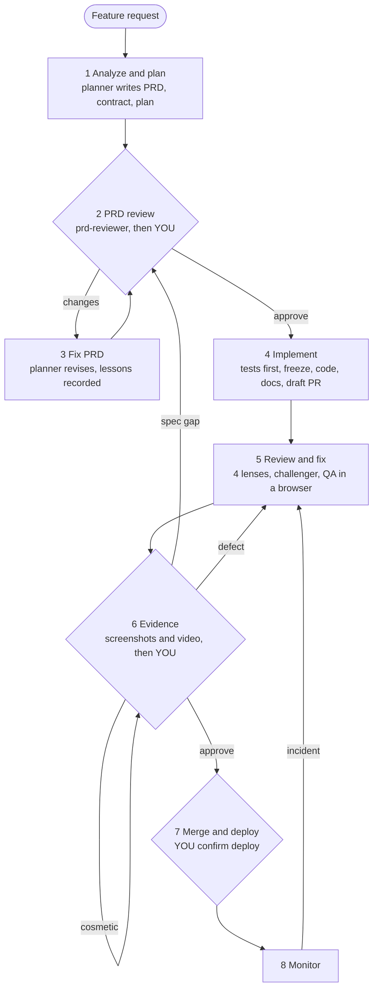
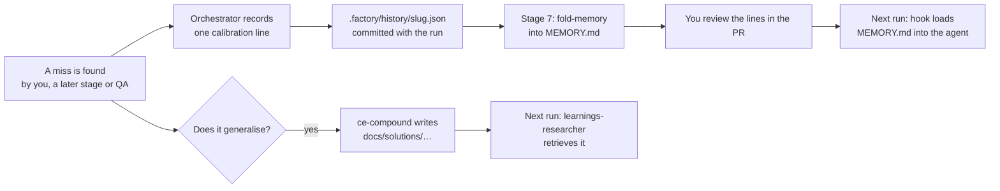

# factory: user guide

How the harness works, how to run a feature through it, how to watch it, how to keep control of what it
produces, and how it learns from your feedback.

> **Build status (v0.1.0).** Stages 1–5 are complete: the orchestrator instructions, the agents, the hooks
> and the harness scripts, with unit tests and live hook tests. Stages 6–8 have their instructions and
> agents, but four scripts are still to come: `evidence.sh` (M5), `ship.sh` and `monitor.sh` (M6), and
> `stats.sh` (M7). Until then the orchestrator stops at the start of stage 6 and reports the missing
> script. Sections that depend on these scripts are marked *(M5)*, *(M6)* or *(M7)*.

---

## 1. The idea in one picture



Three rules hold the whole thing together:

1. **Agents do the work; scripts decide pass or fail.** Whether a check passed comes from an exit code,
   and whether an acceptance criterion is met comes from JUnit test reports. No agent can declare
   success.
2. **Tests come before code, and then they're frozen.** The tests and the files that define "the checks"
   (`package.json`, runner and lint configs, CI, `.factory/config.yaml`) are hashed before any product
   code exists. The implementer can't change them to make the work pass.
3. **You approve three things:** the PRD (stage 2), the evidence (stage 6) and the deploy (stage 7).
   Each approval is tied to a commit, and going back a stage cancels it.

### Who does what

| Agent | Job | Model and effort | Can edit files? |
|---|---|---|---|
| Orchestrator (`/factory:run`, your session) | Routes work, runs scripts, stops at gates | Opus, high | Only run state, through scripts |
| `planner` | Writes `prd.md`, `contract.json` and `plan.md` | Opus, high | Spec files |
| `prd-reviewer` | Reviews the PRD in a fresh context | Opus, high | No |
| `learnings-researcher` | Finds past lessons before planning and review | Opus, low | No |
| `researcher` (optional) | Answers specific outside questions | Opus, medium | No |
| `test-author` | Writes one or more `@AC-n` tests per criterion | Opus, high | Tests |
| `test-reviewer` | Checks every criterion is covered and every assertion means something | Opus, high | No |
| `implementer` | Writes the code, then the docs | Opus, **low** on the first pass; a **fresh** spawn at **high** for each retry | Product code |
| `reviewer-correctness`, `reviewer-spec` | Blocking review lenses | Opus, high | No |
| `reviewer-security` | Blocking lens | Opus, high (xhigh on risky diffs) | No |
| `reviewer-maintainability` | Advisory lens | Opus, medium | No |
| `challenger` | Tries to refute each blocking finding | Opus, high | No |
| `qa-evaluator` | Drives the running app, one pass or fail per criterion | Opus, high | No |
| `triager` | Classifies your comments and production incidents | Opus, high | No |

You can override a model or effort per agent in `roles:` (see §5.5). Do it only after `/factory:stats`
shows the override holds up on your own runs.

---

## 2. One-time setup

1. **Install the plugins.**
   ```sh
   claude plugin marketplace add EveryInc/compound-engineering-plugin
   claude plugin marketplace add <factory marketplace: git URL or local path>
   claude plugin install factory@factory      # installs compound-engineering too
   ```
2. **Open the project in Claude Code and run `/factory:init`.** It:
   - runs `doctor.sh`: Claude Code ≥ 2.1.311, hooks not disabled, no other plugin named `factory`,
     `CLAUDE_CODE_EFFORT_LEVEL` unset, compound-engineering enabled, `git`, `jq` and `python3` present;
   - runs the compound-engineering contract test (about a minute; it checks that the version you have
     still behaves the way factory's learning capture expects);
   - writes `.factory/config.yaml` from your build files and runs each check once to prove the commands
     exist;
   - for web projects, offers to install `@playwright/cli`;
   - adds `.factory/runs/` and `.factory/incidents/` to `.gitignore`.
3. **Review `.factory/config.yaml`** (template: `plugins/factory/templates/factory.config.yaml`). The
   parts that matter most:
   - `checks.fast`: run after every implementer turn. Keep them under about 7 minutes; the gate has a
     14-minute limit.
   - `checks.slow`: integration and e2e, run by the orchestrator.
   - Every check must write JUnit XML into `$FACTORY_REPORTS`. That's how a test named `@AC-3 …` turns
     criterion AC-3 green.
   - `checks.check_defining`: the files frozen alongside the tests.
   - `limits`: round limits and the budget.
   - `ship` and `monitor`: your deploy, smoke, rollback and health commands. Leave them empty until you
     need them.
4. **Commit** the config and `.gitignore` changes.

> If `CLAUDE_CODE_EFFORT_LEVEL` is set in your shell, unset it and restart Claude Code. It overrides
> every agent's effort, including the per-role levels factory sets, so `/factory:run` refuses to start
> until you either unset it or explicitly accept running every agent at that one level.

---

## 3. Running a feature, step by step

Start a run:

```
/factory:run "Add a dark-mode toggle to the settings page"
```

The orchestrator proposes a short slug (for example `dark-mode-toggle`) and asks you to confirm it. From
then on, everything for the run lives in three places:

| Where | What | In git? |
|---|---|---|
| `docs/specs/<slug>/` | `prd.md`, `contract.json`, `plan.md`, `feedback/` | Committed |
| `.factory/history/<slug>.json` | The run's measurement record and lesson lines | Committed |
| `.factory/runs/<slug>/` | State, freeze hashes, reports, logs, evidence | Ignored |

One run per checkout. For a second feature in parallel, start another session with `claude --worktree`;
each run gets its own branch and dev-server port.

### Stage 1: analyze and plan (automatic)

1. Updates the default branch, then creates `factory/<slug>` and records its base commit.
2. `learnings-researcher` pulls relevant past lessons from `docs/solutions/`.
3. Optionally, `researcher` answers outside questions (an API's limits, a standard).
4. `planner` writes:
   - **`prd.md`**, at product level: the problem, users, scope and non-goals, UX flows including empty,
     loading, error and permission states, and acceptance criteria in EARS form ("WHEN … THE SYSTEM
     SHALL …"), each with the test level that will prove it. Also NFRs, risks, rollout, and the
     monitoring signals.
   - **`contract.json`**: one entry per criterion, with `passes: false`.
   - **`plan.md`**: implementation steps (advisory), plus an `## Exceptions` list for any dependency or
     check-file change the work genuinely needs.
5. Commit: `factory(<slug>): 1 plan`.

### Stage 2: PRD review (⏸ your gate)

1. `prd-reviewer` reviews the PRD in a fresh context. Is each criterion testable? Are all the states
   covered? Does every quoted figure appear in its cited source?
2. **You see** the criteria list, the reviewer's findings by severity, and the open questions. Choose:
   - **Approve**: the approval is recorded against the current commit, and the run moves to stage 4.
   - **Request changes**: type your comments. They're saved word for word to
     `docs/specs/<slug>/feedback/prd-<n>.md` and go to stage 3.
   - **Stop**: the run pauses. Resume it later with `/factory:run <slug>`.
3. If you approve while the reviewer still has blocking findings, you're asked once more, and the
   override is recorded in history.

### Stage 3: fix PRD (automatic, loops back to 2)

The planner revises all three files and answers each finding: what changed, or why it disagrees. Then
the lessons are recorded (§6.2):

- Something **you** caught that the reviewer missed becomes a lesson line for `prd-reviewer`.
- A gap the planner should have covered becomes a lesson line for `planner`.

After `limits.prd_rounds` rounds (3 by default), the orchestrator stops and asks you how to proceed.

### Stage 4: implement, tests first (automatic)

| Step | What happens | What decides |
|---|---|---|
| 4.0 Baseline | Runs every check on the unchanged code and saves the ones already failing; those never block this run | `state.sh baseline` |
| 4a Tests | `test-author` writes `@AC-n` tests at the level the PRD names | — |
| 4a1 Red check | Every new test must **fail** before the code exists. A test that already passes, or that can't be seen in the reports, goes to the reviewer. | `state.sh red-check` |
| 4a2 Test review | `test-reviewer` checks coverage and that every assertion means something; up to 3 rounds | Its verdict |
| Freeze | Commits the tests, then hashes the tests and check-defining files, snapshots the check commands, and saves a copy of the reviewed plan | `state.sh freeze` |
| 4b Code | `implementer` at **low** effort. When it tries to stop, a hook re-verifies the freeze and runs the fast checks; it can't finish while they fail (up to 3 retries). | `subagent-stop.sh` |
| After 4b | Verifies the freeze, runs all checks, and syncs `passes` in `contract.json` from the JUnit reports | `verify-freeze`, `run-checks.sh`, `contract-sync` |
| Retry | On failure: a **fresh** implementer at **high**, briefed with the failure report; up to 2 retries, then you | — |
| 4c Docs | README, docs, CHANGELOG | Fast checks |
| 4d Draft PR | Push, then `ship.pr_open` (default `gh pr create --draft --fill`) | — |

A criterion counts as passing only when at least one test names it and every test that names it passed.

If the implementer reports that a frozen test is wrong, or that it needs a new dependency, it is stopped:

- **A wrong test** goes back through test-author, then test-reviewer, then a re-freeze.
- **A dependency** is added by the planner to `plan.md`'s Exceptions, then re-frozen. Only an Exception
  that was frozen counts. One an agent writes into `plan.md` afterwards is ignored.

### Stage 5: review and fix (automatic)

1. `learnings-researcher` pulls lessons relevant to the diff.
2. Mechanical checks and `contract-sync`. Any failure is a blocking finding.
3. **Depth** (`limits.depth`):
   - **lite**: a small diff (under `lite_max_lines`) that touches nothing on `risk_list`. Runs the
     correctness and spec lenses only.
   - **full**: all four lenses, plus a challenger for each blocking finding.
4. In parallel with the lenses, the app is started on the run's port and `qa-evaluator` drives it with
   `playwright-cli`, giving one pass or fail per criterion with a screenshot or trace as evidence.
5. **Challenger** (full depth only):
   - **confirmed**: stays blocking.
   - **refuted**: becomes advisory.
   - **unproven**: stays blocking until a failing test proves it or can't be written.
6. **Fix loop**, for each blocking finding and each QA fail:
   1. `test-author` writes a failing test that reproduces it.
   2. The red check confirms the new test fails.
   3. `test-reviewer` reviews it, and the freeze is extended to cover it.
   4. A fresh implementer at **high** fixes the code.
7. Only the lenses that blocked review again. After `limits.review_rounds` rounds (2 by default), it
   stops and asks you.

Advisory findings are not fixed automatically; you see them at the stage 6 gate.

### Stage 6: evidence (⏸ your gate) *(M5)*

1. The `@AC-n` e2e tests are the demo script. They run under a demo Playwright config that records a
   video with a chapter per criterion, and screenshots at 1440, 768 and 390 pixels wide. The video is
   converted to mp4 when ffmpeg is installed.
2. A **review pack** is built at `.factory/runs/<slug>/review-pack/index.html`. For each criterion it
   shows the text, its tests, pass or fail, the screenshots and the video chapter. It also lists the
   advisory findings, spend so far and the PR link.
3. **You** approve, comment or stop. The `triager` sorts each comment:

   | Class | Meaning | Where it goes |
   |---|---|---|
   | `spec-gap` | The PRD didn't ask for it | The planner amends the PRD, then back to stage 2 |
   | `defect` | A criterion isn't met | The stage 5 fix loop, starting with a failing test |
   | `cosmetic` | No criterion is affected | A direct fix, then the evidence is captured again |

4. On approval, the approved commit is recorded and the PR is marked ready.

### Stage 7: merge and deploy (⏸ your gate) *(M6)*

1. Merges `origin/<default>` into the branch. On a conflict it stops and asks you.
2. Folds the run's lesson lines into each agent's memory and commits only those files. **You see the
   added lines.**
3. `ship.sh verify` checks that every commit after your evidence approval is either a clean merge from
   main or the memory fold. Anything else sends the run back to stage 6.
4. Merges the PR, then **asks you to confirm the deploy**, showing the deploy and rollback commands.
   Deploy and rollback commands are blocked by a hook unless that approval is recorded.
5. Runs the smoke tests. If they fail, it asks you to roll back, then sends the run to stage 5.

### Stage 8: monitor *(M6)*

See §4.2.

### Resuming and stopping

| You want to | Do |
|---|---|
| Continue a paused run | `/factory:run <slug>` (a new session also tells you which run is active) |
| Restart from a stage | `/factory:run <slug> --from <n>`. Going back cancels approvals given at that stage or later. |
| Abandon a run | Stop at any gate, run `bash <plugin>/scripts/state.sh end` to release the checkout, then delete `.factory/runs/<slug>/` and the branch if you don't need them. The committed spec and history stay. |

---

## 4. Monitoring

### 4.1 Watching a run in progress

| Question | Where to look |
|---|---|
| Where is the run? | `/factory:status`: stage, phase, rounds against limits, approvals with commit SHAs, PR, whether frozen, the criteria table, spend against budget, open incidents |
| What will it cost? | `bash <plugin>/scripts/state.sh spend`: spend by stage and by agent, priced from transcripts |
| Is anything stuck? | The live session: each stage starts with `state.sh stage <n>` and each sub-phase ends with a `factory(<slug>): …` commit (`git log --oneline factory/<slug>`) |
| Did the stop gate actually check the implementer? | `.factory/runs/<slug>/stop-gate.log` and `gate-errors.log`, plus `gate_timeouts` and `gate_errors` in `state.json`. The orchestrator also mentions them in the stage summary. |
| Which tests map to which criteria? | `docs/specs/<slug>/contract.json` (`passes`, `test_ids`) and the JUnit files in `.factory/runs/<slug>/reports/` |
| What was frozen? | `.factory/runs/<slug>/frozen.tsv` (path and hash), `checks.snapshot.json`, `plan.frozen.md` |

**The budget.** Before each agent spawn the orchestrator checks the estimated spend against
`limits.budget_usd`. When it's over, the run stops at the next gate and asks you whether to raise the
limit or stop. Spend is estimated at standard prices and doesn't include fast mode. Agents stopped with
TaskStop are listed as unpriced.

### 4.2 Watching production after a deploy *(M6)*

`monitor.sh` runs your `monitor.checks` commands and compares them with the baseline recorded at deploy.
On an anomaly it files an incident, either `.factory/incidents/I-<n>.md` or a GitHub issue labelled
`factory-incident` (`monitor.report`). It rolls back on its own only when `auto_rollback: true`.

Choose a scheduler with `monitor.scheduler`:

| Scheduler | How | Good for | Limits |
|---|---|---|---|
| `local-loop` | `/loop 15m /factory:monitor <slug>` | The hours right after a deploy | Runs only while the session is idle; expires after 7 days; doesn't catch up on missed runs |
| `launchd` | Runs `.factory/bin/monitor.sh` and shows a macOS notification | A dev machine that stays on | No triage until your next session |
| `github-actions` | Cron workflow, which opens a `factory-incident` issue | Always on | Detects and files only; no Claude in CI, so no Anthropic credential is needed |

**When an incident appears:**

1. The next `/factory:run` or `/factory:status` (and the session-start message) points it out.
2. `triager` correlates it with the deploy commit and the diff, and recommends a rollback or a fix.
3. A rollback needs your explicit yes.
4. The run goes back to stage 5, starting with a test that reproduces the incident, and a postmortem is
   captured as a lesson.

The run stays at stage 8 until `monitor.window_hours` (24 by default) pass without an incident; then it
ends.

---

## 5. Controlling results

### 5.1 Your three gates

| Gate | You are approving | Recorded as | Cancelled when |
|---|---|---|---|
| PRD (stage 2) | What will be built and how it will be judged | `approvals.prd` with the commit SHA | The run goes back to stage 2 or earlier |
| Evidence (stage 6) | What was built, as shown in the review pack | `approvals.evidence` with the SHA | It goes back to stage 6 or earlier, or a commit other than a main merge or the memory fold lands after it |
| Deploy (stage 7) | Running `ship.deploy` | `approvals.deploy` | It goes back to stage 7 or earlier |
| Rollback (stage 7) | Running `ship.rollback` | `approvals.rollback` | Same |

Silence or an earlier approval never counts. Free-text comments are always saved word for word under
`docs/specs/<slug>/feedback/`.

**The PRD gate is the cheapest place to steer.** Everything downstream is judged against the acceptance
criteria, so a missing state ("what does the empty list look like?") is far cheaper to add here than at
stage 6.

### 5.2 What the harness enforces for you

| Guard | Stops | How |
|---|---|---|
| Freeze | The implementer weakening a test, a test config, `package.json` scripts, lint rules, CI or the factory config | Hooks block Edit and Write on frozen files. Hashes are re-checked when the implementer stops and after each pass, which also catches changes made through the shell. |
| Read-only roles | Reviewers, QA, challenger and triager changing files | A hook blocks their edits. The working tree is hashed before and after each read-only batch; a change is stashed and logged as an incident. |
| Spec and state protection | Agents editing the PRD, the run state, the history or Claude Code's settings during a run | Hook |
| Agent memory | Agents writing their own memory | Hook. Only the harness writes it, at stage 7. |
| Bash guard | Force-push or deleting a protected branch, skipping git hooks (`--no-verify`, `HUSKY=0`), `rm -rf` of `/` or home, `pkill`/`killall`, and deploy or rollback outside an approved stage 7 | Hook, always on (not only during a run); sees through quoting, `bash -c`, `eval`, `command`, `exec` and `xargs` |
| Fail closed | A guard crashing or hanging and letting the action through | `gate.sh` turns a crash or timeout into a block inside factory projects |
| Fresh retries | A retry inheriting the failed attempt's wrong assumptions | Each retry is a new agent, briefed with the failure report |

These guards are a seatbelt, not a security boundary. A determined shell command could still rewrite
both the run state and the plan snapshot. **The PR diff and your gates are the real boundary**, so
review the PR.

### 5.3 Reviewing the PR

The commits are labelled by sub-phase, so the PR reads in order:

1. `1 plan`, `3 prd round <n>`: the spec as approved.
2. `4a tests`: what "done" means. Check that the tests assert behaviour, not implementation.
3. Code and `4c docs`.
4. Fix-loop commits: each starts with a failing test.
5. `fold memory`: the lesson lines going into agent memory. **Read these**; they shape future runs.
6. `.factory/history/<slug>.json`: rounds, retries, escalations, issues, spend.

### 5.4 Limits that make it stop and ask

| Setting | Default | When it runs out |
|---|---|---|
| `limits.prd_rounds` | 3 | Asks how to proceed with the PRD |
| Test-review rounds | 3 | Asks you |
| Implementer retries | 2 (after the first pass) | Asks you, with the failing checks |
| `limits.review_rounds` | 2 | Asks you, with the open findings |
| `limits.evidence_rounds` | 3 | Asks you |
| `limits.budget_usd` | 60 | Pauses at the next gate |

Each escalation is recorded in history, so `/factory:stats` can show where runs get stuck.

### 5.5 Knobs

| Setting | Effect |
|---|---|
| `limits.depth: lite \| full \| auto` | Review breadth: two lenses, or four plus a challenger |
| `limits.lite_max_lines`, `risk_list` | What `auto` treats as small and safe |
| `roles.<agent>: {model, effort}` | Per-agent override, for example `implementer: {model: sonnet, effort: medium}`. Use only after stats show parity. |
| `learning.enabled` | Turns lesson capture on or off |
| `learning.rubric_visible` | Whether the implementer sees reviewer rubrics (default false; an experiment `stats` can compare) |

The config is frozen during a run. Edits take effect on the next run.

---

## 6. Self-learning

### 6.1 Three layers

| Layer | What it holds | Written by | Read by | Where |
|---|---|---|---|---|
| **Project knowledge** | One document per lesson that generalises: symptom, wrong first guess, root cause, fix, what to check next time | compound-engineering's `ce-compound`, called by the orchestrator | `learnings-researcher` before planning and before review | `docs/solutions/` (committed) |
| **Per-agent calibration** | Short "check this next time" lines for the agent that missed something | Only the harness: lines are recorded during the run and folded in at stage 7 | Each factory agent, loaded at spawn by a hook (first 200 lines or 25 KB) | `.claude/agent-memory/factory-<agent>/MEMORY.md` (committed) |
| **Your corrections** | Claude Code's built-in auto memory | Claude Code | Your sessions | Claude Code's memory (optional) |

### 6.2 How a lesson travels



**When lines are recorded:**

- **Stage 3:** you caught something the PRD reviewer missed → a line for `prd-reviewer` (and for
  `planner` if it should have covered it).
- **Stage 5:** a lens missed a confirmed issue that another lens, QA or a human found → a line for that
  lens. A challenger's refutation with execution evidence → a line for the lens that raised it.
- **Stage 6:** a defect on a criterion QA passed is a **QA false negative** → a line for `qa-evaluator`,
  plus a candidate eval case.
- **Stage 8:** an incident → a postmortem through ce-compound.

**What a good line looks like:** specific and testable, written as a check. For example: "check every
list view has an empty-state criterion". Never a rule that overrides the task, and never secrets or user
data.

**Agents' own suggestions.** Every agent ends its report with a `lessons` list. These are candidates
only: one becomes a calibration line when a stage outcome confirms it, never directly.

### 6.3 Why it's built this way

- **Agents never write their own memory.** Research on self-evolving agents (*Your Agent May
  Misevolve*, ICLR 2026) found that memory an agent writes for itself increases reward hacking. Here,
  memory changes only through lines the harness recorded, and you see every one in the PR.
- **Memory is "reference material, not rules."** Each agent is told this when its memory is loaded. The
  same paper found that this framing reduces the harm from a bad memory.
- **Folding happens once, at stage 7, after merging main,** so parallel runs never conflict on
  `MEMORY.md`.
- **`ce-compound` has a durability bar.** It skips lessons the code already makes obvious. "Documentation
  skipped" is a normal outcome, recorded and not retried.

### 6.4 Curating memory yourself

- **Remove or rewrite a line:** edit `MEMORY.md` in a normal commit, outside a run. Agents can't, but you
  can.
- **Size:** each `MEMORY.md` is capped at `learning.memory_max_lines` (150). The oldest lines move to
  `archive.md` in the same folder, which isn't loaded. `/factory:stats` *(M7)* lists agents near the cap
  so you can consolidate them.
- **Project knowledge:** `docs/solutions/` is ordinary markdown. compound-engineering's
  `ce-compound-refresh` consolidates it when ce-compound recommends a refresh, or every
  `learning.refresh_ceiling` runs.
- **Turn it off:** `learning.enabled: false`.

### 6.5 Measuring whether it works *(M7)*

Each run's committed history file records:

- issues found by humans, by stage and type
- QA false negatives
- implementer first-pass rate by model and effort
- fix rounds, escalations and incidents
- spend by stage and by agent
- review depth
- ce-compound outcomes and the compound-engineering version
- calibration lines

`/factory:stats` reads all of them. Use it to:

- **See whether learning helps.** Human-found issues per run should fall for the classes that have
  lessons.
- **Decide on overrides.** Recommend `roles.implementer: {model: sonnet, …}` only when its runs match
  Opus on first-pass rate, fix rounds and human-found defects. With fewer than about 10 runs per arm,
  treat any difference as directional only.
- **Tune depth.** Compare defects reaching stage 6 or production under `lite` and `full`.
- **Grow the evals.** `--export-evals` turns QA false negatives into candidate eval cases under
  `.factory/eval-candidates/`.

### 6.6 Agent evals

The plugin's `evals/` directory holds `claude plugin eval` cases for the agents. Re-run them whenever an
agent prompt changes. The seed case, a PRD with no empty-state criterion, scored 1.00 with the plugin and
0.17 without it (3 runs each). Review an exported candidate before adding it.

---

## 7. Reference

### Commands

| Command | Use |
|---|---|
| `/factory:init` | Once per project, and again after upgrading factory or compound-engineering |
| `/factory:run "<feature>"` | Start a run |
| `/factory:run <slug> [--from <n>]` | Resume, or restart from a stage |
| `/factory:status [slug]` | One-screen state of a run; read-only |
| `/factory:monitor <slug>` | One round of production checks *(M6)*; pair with `/loop` |
| `/factory:stats [--since <date>] [--export-evals]` | Measurements across runs *(M7)* |

### Files in your project

```
.factory/
  config.yaml                committed   checks, limits, roles, ship, monitor, learning
  history/<slug>.json        committed   measurements and lesson lines, one file per run
  bin/monitor.sh             committed   copy used by CI and launchd (M6)
  runs/<slug>/               ignored     state.json, frozen.tsv, checks.snapshot.json, plan.frozen.md,
                                         baseline-failures, reports/, evidence/, review-pack/,
                                         stop-gate.log, gate-errors.log
  incidents/I-<n>.md         ignored     production incidents (M6)
docs/specs/<slug>/           committed   prd.md, contract.json, plan.md, feedback/
docs/solutions/              committed   project knowledge (compound-engineering)
.claude/agent-memory/factory-<agent>/
  MEMORY.md, archive.md      committed   per-agent calibration
```

### Troubleshooting

| Symptom | Cause and fix |
|---|---|
| "run is refused: CLAUDE_CODE_EFFORT_LEVEL is set" | Unset it and restart Claude Code, or confirm running every agent at that one level |
| "another run is active" | One run per checkout. Finish it, or use `claude --worktree`. |
| "Blocked by factory: … is a frozen test" | Intended. If the test really is wrong, the implementer says so and the orchestrator sends it back through test-author. |
| "Blocked by factory: … defines the project's checks" | Intended. A real need goes through a plan Exception and a re-freeze (§3, stage 4). |
| `freeze` refuses: a check file differs from the base | It was changed on the branch before the freeze. Revert it, or add a plan Exception the PRD review covers. |
| A hook blocks everything with "jq is missing" | Install `jq` and `python3`. Inside a factory project the guards fail closed. |
| The stop gate timed out | The fast checks take too long (more than about 14 minutes). Move slow ones to `checks.slow`. `state.sh baseline` warns when the fast set takes over 7 minutes. |
| "compound-engineering … hasn't passed factory's contract test" | Run `/factory:init`, or let `/factory:run` run the test. Learning capture is off until it passes. |
| An edit is blocked though no run should be active | The file guards act only while a run is active in that checkout. Check `/factory:status`, and end a finished run with `state.sh end`. (The Bash guard is always on, by design.) |
